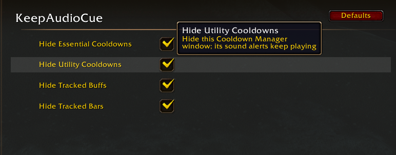

# KeepAudioCue

Hides the windows of Blizzard's Cooldown Manager (cooldown and buff tracker) while their
sound and text-to-speech alerts keep playing.

Blizzard plays these alerts only while a window is shown, so hiding it in Edit Mode or
disabling the Cooldown Manager silences them. KeepAudioCue hides the window instead and
leaves it running in the background.

## Features

- **Hide per window** - Essential Cooldowns, Utility Cooldowns, Tracked Buffs, and Tracked
  Bars can each be hidden; their alerts keep playing.
- **Edit Mode friendly** - hidden windows reappear in Edit Mode for positioning.
- **Warnings** - tells you when Edit Mode visibility or a disabled Cooldown Manager still
  silences a window you hide here.
- **Remembered** - settings are saved per account, or per character with one checkbox;
  default is off.
- **Settings page** - all options in the game menu under Options > AddOns, also opened
  from the addon compartment menu.
- **Chat commands** - every option can also be changed by slash command.

## Screenshots



## Install

1. Download `KeepAudioCue-vX.Y.Z.zip` from the
   [releases](https://github.com/tf4482/KeepAudioCue/releases) (or CurseForge, Wago).
2. Unzip it into `World of Warcraft/_forever_/Interface/AddOns/`.
3. Restart the game or type `/reload`.
4. Keep the Cooldown Manager enabled and set the Edit Mode visibility of every window you
   want to hear to **Always**; hide it with KeepAudioCue instead.

## Usage

```text
/kac                   show the state of all windows
/kac essential hide    hide Essential Cooldowns, alerts keep playing
/kac essential show    show Essential Cooldowns again
/kac utility hide|show Utility Cooldowns
/kac buffs hide|show   Tracked Buffs
/kac bars hide|show    Tracked Bars
/kac character on      use settings for this character only
/kac character off     use the account settings again
/kac test              apply all windows and check their alerts now
/kac reset             reset the settings to defaults
/kac debug on          show what the addon does, until /reload
/kac config            open the settings page
/kac help              list all commands
```

## Examples

- You only want the voice for your defensive cooldowns: `/kac utility hide`, then set up
  the alerts in the Cooldown Manager settings as usual.
- You use another buff display but want Blizzard's buff sounds: `/kac buffs hide` and
  `/kac bars hide`.
- A window still stays silent: `/kac` shows the reason, e.g. Edit Mode visibility
  "Hidden" or "In Combat"; set it to "Always".
- Different windows per character: `/kac character on` on that character, then hide the
  windows it should not show.

## Develop

Check the code with [Luacheck](https://github.com/lunarmodules/luacheck) before each commit
(CI runs it on every push):

```text
luacheck .
```

Deploy locally: run `deploy.bat`; it builds `release/KeepAudioCue-vX.Y.Z.zip` from `VERSION`.

Release: set `VERSION` to `X.Y.Z`, then push an annotated tag `vX.Y.Z`; GitHub Actions
packages the addon with the BigWigs packager and publishes it.

## License

All rights reserved, see [LICENSE](LICENSE).
